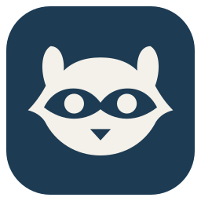

<div align="center">
  
  <h1>uac-linux</h1>
  <p><strong>限时免密 sudo，在 GNOME 顶栏一键开关。</strong></p>
  <p><a href="README.md">English</a> · 中文说明</p>
</div>

---

输入一次密码，接下来几个小时 `sudo` 不用再输密码。到时间自动恢复。

## 用法

| 顶栏 | 状态 |
|:---:|---|
|  | sudo 要密码 |
|  | 免密已开启 |

点浣熊，选 1–24 小时（默认 6 小时）开启，或立即关闭。到期时间在菜单里。

```console
uac on 6       # 开启 6 小时
uac off        # 立即关闭
uac status     # 当前状态
uac logs 7d    # 审计记录
uac doctor     # 检查安装
```

## 安装

```bash
git clone https://github.com/Nongfsq/uac-linux.git
bash uac-linux/scripts/install.sh
```

需要 Ubuntu + GNOME、systemd、Rust 1.89 以上（`sudo apt install cargo`），账户在 `sudo` 组里。安装脚本会把 `sudo` 切到经典 sudo，因为 sudo-rs 不支持 `NOTAFTER`。

卸载：`bash scripts/uninstall.sh`

## 原理

- 授权就是一条带 `NOTAFTER` 的 sudoers 规则，到点由 sudo 自己失效。
- 每次开启和关闭都记进 journal（标签 `uac-linux`）。
- 授权期间，你账户下的所有程序都能用 root。

## 语言

支持 English 和简体中文，跟随系统语言。要加新语言，把 `crates/uac-i18n/i18n/en-US/uac-i18n.ftl` 复制到新的语言目录再翻译即可。

## 开发

`bash scripts/check.sh` 运行全部检查。安全问题请看 [SECURITY.md](SECURITY.md)。

## 许可证

[MIT](LICENSE)
